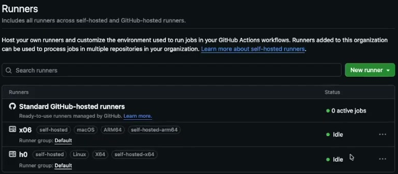

# OpenVADL CI server setup and operations

This guide documents the OpenVADL CI server infrastructure. 
There is also a private video walk through, see [Chapter 10](#10-video-navigation).

## 1. Server overview

| Machine | Role | Login | Runner labels |
|---|---|---|---|
| `mips` | Public-facing access/proxy server; the intended entry point to the internal machines | Personal institute account through `mips.complang` | Not a CI runner |
| `h0` aka Linux Box | Debian Linux, x86-64; slower CI runner | `root@h0`, from MIPS | `self-hosted`, `Linux`, `X64`, `self-hosted-x64` |
| `x06` aka Mac Mini| macOS, ARM64; faster CI runner, using OrbStack for containers | `vadl@x06`, from MIPS | `self-hosted`, `macOS`, `ARM64`, `self-hosted-arm64` |

The runner labels as they appear in the GitHub UI:



The connection sequence is:

```text
Your computer → MIPS → h0 (root)
                    → x06 (vadl)
```

Both runners are registered with the **OpenVADL organization**, allowing organization repositories to use them. They appear in **OpenVADL → Settings → Actions → Runners**, in the `Default` runner group.


## 2. Access and SSH configuration

### Get access provisioned

First obtain access to MIPS (Herbert). Then create a key on MIPS and give its **public key** to any team member who already has access to `h0` and `x06`, they can install it for the Linux root account and the Mac account.

### Configure the MIPS alias on your computer

Edit `~/.ssh/config`:

```sh
vim ~/.ssh/config
```

Add the following entry, replacing `<your-mips-user>`, `<your-private-key>`  and using the appropriate local private-key path:

```sshconfig
Host mips.complang
    HostName mips.complang.tuwien.ac.at
    User <your-mips-user>
    HostKeyAlgorithms +ssh-rsa
    PubkeyAcceptedKeyTypes +ssh-rsa
    IdentityFile <your-private-key>
    ForwardAgent yes
```

The two `ssh-rsa` lines are important for this connection. These are host-specific compatibility settings, not a general requirement for every SSH server. Agent forwarding is also present.


### Log into h0, the Linux Box 

```sh
# On your own computer:
ssh mips.complang

# In the resulting MIPS shell:
ssh root@h0
```

A successful second login produces a Debian banner and a `root@h0` prompt.

### Log into x06, the Mac Mini

From MIPS:

```sh
ssh vadl@x06
```

## 3. Linux runner: service and working directories

### Locate and check the service

The runner runs under the dedicated **`github-runner`** user rather than root. Its installation directory is:

```text
/home/github-runner/actions-runner
```

Use the root shell to inspect and manage the installed service:

```sh
cd /home/github-runner/actions-runner
ls
./svc.sh help
./svc.sh status
```

The help output lists `install`, `start`, `stop`, `status`, and `uninstall`. Installation is already done and does not need to be repeated. For existing-service management:

```sh
./svc.sh start
./svc.sh stop
./svc.sh status
```

It should be **loaded, enabled, and active (running)**. Sample output:

```bash
$ ./svc.sh status

/etc/systemd/system/actions.runner.OpenVADL.h0.service

● actions.runner.OpenVADL.h0.service - GitHub Actions Runner (OpenVADL.h0)
     Loaded: loaded (/etc/systemd/system/actions.runner.OpenVADL.h0.service; enabled; vendor preset: enabled)
     Active: active (running) since Mon 2026-10-20 08:15:23 CEST; 4 days ago
   Main PID: 1234 (runsvc.sh)
      Tasks: 8 (limit: 18915)
     Memory: 125.4M
        CPU: 2min 14.512s
     CGroup: /system.slice/actions.runner.OpenVADL.h0.service
             ├─1234 /home/github-runner/actions-runner/runsvc.sh
             └─1256 /home/github-runner/actions-runner/bin/Runner.Listener run --startuptype service

Oct 24 10:32:23 h0 Runner.Listener[1256]: Listening for Jobs (OpenVADL/h0)
Oct 24 10:32:24 h0 Runner.Listener[1256]: Runner reconnected successfully
```

Docker and the Linux runner are expected to start automatically after a reboot.

### Find a CI checkout

The `_work` directory is inside the runner installation, not directly inside the user's home directory.

```sh
cd /home/github-runner/actions-runner
ls _work/
cd _work/openvadl/
ls
ls openvadl/
```

The actual OpenVADL repository checkout is nested one level further:

```text
/home/github-runner/actions-runner/_work/openvadl/openvadl
```

The directory listing also shows work areas such as `doxygen` and `resselpark`, together with runner-managed directories such as `_actions`, `_temp`, and `_tool`.

Treat the repository directory as CI-managed workspace; manual edits may not persist between jobs.

### Work as the runner user

From the Linux administrative shell:

```sh
sudo -u github-runner bash
```

The prompt changes to `github-runner@h0`. This user has no password, so the administrative user switch is the intended access method. The command keeps the current working directory.

```text
root@h0:~# sudo -u github-runner bash
github-runner@h0:~$ whoami
github-runner
```

### Job concurrency and triggering

- Each runner processes **one job at a time**.
- Multiple runner installations could exist on one host, even under the same user in separate directories. This is possible but not part of this setup.
- The heavier CI tests already use multiple threads and make good use of the machine, limiting the benefit of adding competing runners.
- Jobs normally arrive through the runner's connection to GitHub. There is no supported way to trigger a GitHub workflow locally through the runner installation.

## 4. Choose the appropriate runner

The team generally uses the custom architecture labels shown at the end of each runner's label list:

| Need | Label | Guidance |
|---|---|---|
| Either machine is acceptable | `self-hosted` | Architecture does not matter |
| Linux x86-64 specifically | `self-hosted-x64` | Targets `h0` |
| ARM64 Mac specifically | `self-hosted-arm64` | Targets `x06` |

**Illustrative YAML:**

```yaml
runs-on: self-hosted
```

```yaml
runs-on: self-hosted-x64
```

```yaml
runs-on: self-hosted-arm64
```

The Mac is substantially faster. For CI turnaround, prefer putting the relevant tasks on the Mac, because a task assigned to slow `h0` can delay the whole run. Use `h0` for work whose elapsed time is less important, preserving Mac capacity. Benchmarks run on `h0`; for tracking performance changes over time, keep the runner consistent.

## 5. Linux storage and the recurring disk-space problem

### Docker data is on a separate disk

Running Docker's `overlay2` storage on the previous ZFS arrangement caused layer cleanup problems and rapid disk growth. The workaround was to move Docker data to a separate disk.

```sh
ls -al /var/run/docker.sock
df -h
```

The output distinguishes these locations:

| Location | Storage arrangement |
|---|---|
| `/var/lib/docker` | Separate device `/dev/sda1`; 1.8T total, 335G used, 1.4T available |
| `/home` | ZFS dataset `rpool/home`; includes the CI workspace |
| `/bu` | ZFS dataset `rpool/bu`; contains the backup directory |
| `/var/run/docker.sock` | Linux Docker socket; owned by `root:docker` |

The Docker disk and the ZFS pool are different capacity domains. Free space on the Docker disk does not prevent backups from filling the storage used by the runner workspace.


### Inspect backups when ZFS space runs low

```sh
df -h
cd /bu/backup/
ls
ls -alh
```

The directory contains large `.tgz` archives. The listing shows **545G total** and recent home archives of roughly **26–27G each**. The displayed available space for several `rpool` datasets is **241G**; these are historical readings, not current capacity.

Accumulated backups are the recurring reason CI can run out of space and fail. Old archives have been deleted previously while keeping some early backups from each year. No formal retention policy is established.

For an incident, use the displayed commands to identify the affected filesystem and inspect the archive sizes. Confirm which archives may be removed with the backup owner before deleting them.


## 6. Mac runner and OrbStack

### Check the runner

After logging into `x06` as `vadl`:

```sh
cd ~/actions-runner
ls
./svc.sh status
```

The absolute runner directory is:

```text
/Users/vadl/actions-runner
```

The status command reports the LaunchAgent file and a started service:

```text
/Users/vadl/Library/LaunchAgents/actions.runner.OpenVADL.x06.plist
```


### Start OrbStack when needed

OrbStack supplies the container environment on the Mac.

```sh
orb -h
orb start
```

The help distinguishes `orb`, used for OrbStack and Linux-machine operations, from `docker`, used for Docker containers.

### Understand the boot/login dependency

In this setup, **`vadl` must log in automatically to a graphical macOS session** after boot so the required user-session privileges and services work. An SSH connection alone is not sufficient. The machine boots successfully without a display or mouse attached.

OrbStack has failed to start automatically in the past. Adding it through macOS **Login Items** is proposed, but this has not been configured. The runner has its own LaunchAgent (described below); its presence does not mean OrbStack itself is configured to launch at login.

### Check BuildKit

```sh
docker ps
```

Expected output:

| Field | Value |
|---|---|
| Image | `moby/buildkit:latest` |
| Container name | `buildkitd` |
| Status | `Up 2 days` |
| Published ports | `0.0.0.0:1334->1334/tcp`, `[::]:1334->1334/tcp` |


The BuildKit image needs to have been pulled and should start automatically. The exact creation/start command and restart configuration are not documented. The project uses BuildKit directly for image builds rather than the normal Docker-build route.

**If BuildKit is absent:** inspect stopped containers with `docker ps -a`.

## 7. Mac LaunchAgent and exact Docker environment

Inspect the existing configuration with:

```sh
cat /Users/vadl/Library/LaunchAgents/actions.runner.OpenVADL.x06.plist
```

The file launches `/Users/vadl/actions-runner/runsvc.sh` as `vadl`, with `/Users/vadl/actions-runner` as its working directory. It sets `RunAtLoad` to true, `ProcessType` to `Interactive`, and `SessionCreate` to true.

The environment in the file is:

```text
ACTIONS_RUNNER_SVC=1
TESTCONTAINERS_DOCKER_SOCKET_OVERRIDE=/var/run/docker.sock
DOCKER_HOST=unix:///Users/vadl/.orbstack/run/docker.sock
```

These two socket values intentionally differ. Both the Testcontainers override and the OrbStack-specific `DOCKER_HOST` are important. Previously, CI selected another container environment (Docker Desktop or Colima); explicitly setting the runner environment fixed that selection. Processes started by the runner inherit these values.


### Configuration reference

Whitespace has been normalized. This is a reference copy of the existing file, not an instruction to overwrite a live configuration:

```xml
<?xml version="1.0" encoding="UTF-8"?>
<!DOCTYPE plist PUBLIC "-//Apple//DTD PLIST 1.0//EN" "http://www.apple.com/DTDs/PropertyList-1.0.dtd">
<plist version="1.0">
<dict>
    <key>Label</key>
    <string>actions.runner.OpenVADL.x06</string>
    <key>ProgramArguments</key>
    <array>
        <string>/Users/vadl/actions-runner/runsvc.sh</string>
    </array>
    <key>UserName</key>
    <string>vadl</string>
    <key>WorkingDirectory</key>
    <string>/Users/vadl/actions-runner</string>
    <key>RunAtLoad</key>
    <true/>
    <key>StandardOutPath</key>
    <string>/Users/vadl/Library/Logs/actions.runner.OpenVADL.x06/stdout.log</string>
    <key>StandardErrorPath</key>
    <string>/Users/vadl/Library/Logs/actions.runner.OpenVADL.x06/stderr.log</string>
    <key>EnvironmentVariables</key>
    <dict>
        <key>ACTIONS_RUNNER_SVC</key>
        <string>1</string>
        <key>TESTCONTAINERS_DOCKER_SOCKET_OVERRIDE</key>
        <string>/var/run/docker.sock</string>
        <key>DOCKER_HOST</key>
        <string>unix:///Users/vadl/.orbstack/run/docker.sock</string>
    </dict>
    <key>ProcessType</key>
    <string>Interactive</string>
    <key>SessionCreate</key>
    <true/>
</dict>
</plist>
```

The file identifies the log locations:

```text
/Users/vadl/Library/Logs/actions.runner.OpenVADL.x06/stdout.log
/Users/vadl/Library/Logs/actions.runner.OpenVADL.x06/stderr.log
```

**Diagnostic:**

```sh
tail -n 100 /Users/vadl/Library/Logs/actions.runner.OpenVADL.x06/stderr.log
```

### Check Docker context selection

```sh
docker context ls
```

The output lists `colima`, `default`, `desktop-linux`, and `orbstack`. Both the active `default` entry and `orbstack` point at:

```text
unix:///Users/vadl/.orbstack/run/docker.sock
```

The terminal warns that **`DOCKER_HOST` overrides the active context**. Changing the selected Docker context alone does not resolve an incorrect runner-level `DOCKER_HOST` value.

Note: `docker ls` is not a valid command. Use `docker context ls` for contexts and `docker ps` for running containers.


## 8. Incident reference

The checks below assemble the documented commands into a troubleshooting order.

| Symptom | First checks | Conclusion |
|---|---|---|
| Cannot reach an internal machine | Log into MIPS, then use `ssh root@h0` or `ssh vadl@x06` | MIPS and target-account key provisioning are separate access steps |
| Linux runner unavailable | In `/home/github-runner/actions-runner`, run `./svc.sh status` | Inspect service state and recent connection/job messages |
| Linux CI fails because storage is full | `df -h`, then inspect `/bu/backup/` with `ls -alh` | Large backup archives can fill ZFS space used by the workspace |
| Mac runner unavailable after reboot | Confirm the `vadl` graphical login, then check `./svc.sh status` | The setup depends on the user session and LaunchAgent |
| Mac containers unavailable | `orb start`, then `docker ps` | OrbStack autostart is a known unresolved configuration item |
| CI uses the wrong Docker backend | Read the LaunchAgent environment and run `docker context ls` | The runner's explicit `DOCKER_HOST` must point at OrbStack |
| Image building fails | Check `docker ps` for `buildkitd` | The expected image is `moby/buildkit:latest`; creation details are not documented |
| CI uploads fail despite the usual services running | No established fix | An upload problem was reported; its cause is unresolved |

## 10. Video navigation

A video walkthrough of this setup exists as **OpenVADL Devlog #8 – CI Server Setup Tour [GERMAN]**. The video is not publicly available, ask fellow team member for the link.

If you have access to the video these timestamps might be helpful.

| Time | Topic |
|---|---|
| 00:06 | MIPS entry point and SSH configuration |
| 00:09 | Login to Linux (first SSH command) |
| 00:31 | Configure the MIPS SSH alias in `~/.ssh/config` |
| 01:37 | Login to `h0` |
| 01:42 | Get access provisioned (key generation discussion) |
| 03:11 | Linux runner user, directory, and service |
| 04:14 | Runner `_work` directory |
| 05:12 | Organization runners, labels, and scheduling choices |
| 05:18 | Choose the appropriate runner (YAML label guidance) |
| 06:51 | Docker, ZFS, and separate-disk arrangement |
| 06:55 | Docker storage layout shown (`df -h`, `docker.sock`) |
| 07:35 | Backup archives and space exhaustion |
| 09:07 | Docker/ZFS failure discussion continued |
| 09:40 | Exact repository workspace path |
| 10:17 | Runner concurrency and resource utilization |
| 11:28 | Docker disk vs. ZFS capacity discussion |
| 11:54 | Routine failures and automatic service startup after reboot |
| 12:36 | Switch to the runner user |
| 13:07 | Job triggering and local workflow discussion |
| 13:58 | Runner user discussion (end of segment) |
| 14:15 | Login to `x06` (Mac) |
| 14:45 | Mac runner service check (`./svc.sh status`) |
| 15:22 | OrbStack startup |
| 15:40 | Boot/login dependency discussion |
| 17:35 | Proposed OrbStack Login Items configuration |
| 18:19 | BuildKit container |
| 19:00 | LaunchAgent file and environment variables |
| 19:45 | BuildKit discussion continued |
| 20:45 | Docker contexts and `DOCKER_HOST` override |
